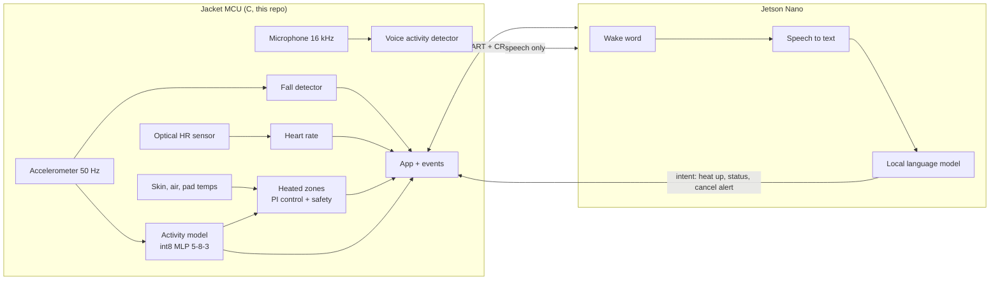

# Smart Jacket Firmware


Reference firmware in C for an AI smart jacket: fall detection, an on-device activity model, heart rate and skin temperature, three heated zones with safety cut-offs, and a voice link to a local AI model on an NVIDIA Jetson Nano.

It is the firmware architecture behind the smart jacket concept from **Edge AGI Wearables**, the side venture I co-founded. The whole thing builds and runs on a laptop against a simulated wearer, so anyone can try it without the hardware.

> Sensors and data here are simulated. Board drivers and pin mapping for the prototype are not part of this repo. Heart rate and temperature readings are comfort and safety hints, not medical measurements.

## Architecture



**Why split it this way:** the MCU (Microcontroller Unit) is always on and sips power, so it does the continuous sensing and the safety rules. The Jetson only wakes when someone actually speaks, which is where the battery goes. Safety never depends on the Jetson: if it crashes, falls are still detected and heaters still cut off.

## What each module does

| Module | File | Key decisions |
|---|---|---|
| Fall detection | `src/imu.c` | Free fall, then impact, then lying still, in that order. Dropping the jacket or jumping does not trigger it. 15 second cancel window (button or voice) before an alert goes out. |
| Activity model | `src/activity_model.c` | Tiny MLP (Multi-Layer Perceptron) with int8 weights, trained by `tools/train_activity.py`. Integer math in the layers, fits in a few hundred bytes. Paused while a fall is being checked, so the impact is not logged as running. |
| Heart rate | `src/vitals.c` | Peak detection with an adaptive threshold and a trimmed average of beat intervals. "High heart rate at rest" only fires after a minute of rest, so stopping after a run is not an alert. |
| Heated zones | `src/heating.c` | One PI (Proportional-Integral) controller per pad. Target adapts to outside temperature and activity (less heat when running). Safety rules run last and can only lower power: 48 C hard cut-off, broken sensor, pad not warming, low battery cap. Faults latch. |
| Voice | `src/voice.c` | Energy-based voice activity detector with an adaptive noise floor. Only speech segments are streamed to the Jetson. Unknown intents are ignored, never guessed. |
| Link to Jetson | `src/protocol.c` | Framed messages with CRC-16. Byte-at-a-time parser that recovers by itself after noise. |
| Hardware layer | `include/hal.h` | All hardware access goes through one small interface. `src/hal_sim.c` implements it for the simulator; a board port implements the same functions. |

## Run it

```bash
make sim && ./build/jacket_sim   # 2-minute scenario with a simulated wearer
make test                        # 221 checks, unit and end-to-end
make model                       # retrain the activity model (needs numpy)
```

Simulation output (trimmed):

```text
--- Running: heart rate climbs, heaters back off ---
   46.0s  EVENT     activity -> run (99% confident)
   60.0s  telemetry run   hr=138 skin=33.4C air=-2.0C pads=36.2/36.2/34.7C duty=50/50/43% batt=80% level=3
--- Fall, wearer does not respond ---
   73.3s  EVENT     FALL DETECTED, buzzing; wearer has 15 s to cancel
   88.3s  EVENT     no response: ALERT sent to emergency contact
--- Wearer gets up and says "make it warmer", then asks for status ---
   93.0s  voice     speech started, Jetson wakes up
   94.5s  voice     speech ended (147 x 10 ms chunks streamed)
   94.5s  jetson    understood: "heat up"
   94.5s  EVENT     heat level -> 4
--- Collar temperature sensor fails ---
  111.0s  EVENT     HEATER FAULT in collar zone: sensor out of range, zone switched off
--- Battery drops to 12%: heater power capped ---
  120.0s  telemetry still hr= 68 skin=32.8C air=-2.1C pads=39.4/39.5/-40.0C duty=40/40/0% batt=12% level=4
```

## Quality

- Builds with `-Wall -Wextra -Wpedantic -Wconversion -Werror` on GCC and Clang.
- Tests also run under AddressSanitizer and UndefinedBehaviorSanitizer in CI (Continuous Integration).
- No dynamic memory allocation. Everything is fixed size, which is what you want on a small MCU.
- The activity model is checked after quantization, not just in float, so the accuracy reported is the accuracy of what ships.

**Honest limits:** the activity model scores 100% on its synthetic test set because the synthetic classes are easy to separate. Real-world accuracy needs labelled data from people wearing the jacket, which is the next step for a real product. The same goes for tuning the fall thresholds.

## Repo layout

```text
include/   Module headers, hal.h hardware interface, generated model weights
src/       Firmware modules, simulated hardware (hal_sim.c), simulation runner (main_sim.c)
tests/     Unit tests per module plus an end-to-end test against the simulator
tools/     train_activity.py: trains, quantizes and exports the activity model
docs/      Message formats between the jacket and the Jetson
```

## About

By [Amir Pournajib](https://amirpournajib.github.io), Technical Product Leader working on agentic AI, connected health and hardware. [LinkedIn](https://www.linkedin.com/in/amir-pournajib)
